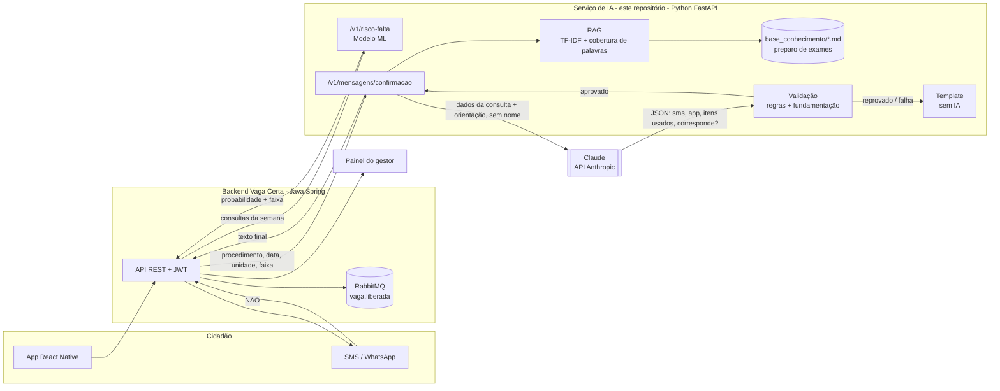

# Vaga Certa — IA contra a falta em consultas do SUS

Global Solution 2026/2 · CitizenTech · **Disruptive Architectures: IoT, IoB & Generative IA**

## Integrantes

| RM | Nome |
|---|---|
| RM00000 | Nome completo |
| RM00000 | Nome completo |
| RM00000 | Nome completo |

## O problema

Uma vaga de especialista ou de exame que levou meses para sair é desperdiçada porque o paciente falta sem avisar.
Enquanto isso, quem está atrás na fila continua esperando. Cerca de 1 em cada 4 pacientes falta: Goiás registrou
26% de faltas, Campo Largo (PR) 1 em 4, e Porto Alegre perdeu mais de 45 mil consultas especializadas em 2025.
Parte das faltas vem de quem esquece. Parte vem de quem chega sem o preparo certo e não consegue fazer o exame.

## O que esta parte do Vaga Certa faz

São três peças de IA que o backend do Vaga Certa (Java/Spring) chama:

| Peça | Técnica | Para quem | O que entrega |
|---|---|---|---|
| Risco de falta | **Machine Learning** (gradient boosting) | Gestor / regulador | Probabilidade de falta de cada consulta, faixa (baixo, médio, alto) e os sinais que pesaram. Com isso a equipe reforça o lembrete de quem tem mais risco e prepara encaixe. |
| Orientação de preparo | **RAG básico** (recuperação em base curada) | Cidadão | O preparo certo do exame agendado (jejum, bexiga cheia, acompanhante etc.), vindo de uma base que a secretaria controla. |
| Mensagem de confirmação | **IA generativa** (Claude, API da Anthropic) | Cidadão | SMS e texto do app em linguagem simples, com data, local, preparo e como confirmar (SIM) ou liberar a vaga (NAO). |

A IA **não diagnostica, não decide quem é atendido e não tira ninguém da fila**. O modelo de risco só muda a
intensidade do lembrete. A IA generativa só reescreve, em linguagem simples, orientações que já estão na base.

### Ligação com IoB (Internet of Behaviors)

O modelo de risco usa dados de comportamento: histórico de comparecimento, antecedência do agendamento e resposta
a lembretes. A resposta do cidadão (SIM, NAO ou silêncio) volta como dado novo para o próximo treino. É o ciclo
"comportamento → dado → decisão → novo comportamento" do IoB, aplicado para tornar a fila mais justa. Ele não é usado
para punir ninguém.

## Arquitetura



Fluxo da mensagem, passo a passo:

1. O backend Java envia procedimento, data, hora, unidade e a faixa de risco. Também pode enviar o primeiro nome, que **fica neste serviço**.
2. O RAG procura o documento de preparo. Abaixo do score mínimo (0,30), nada é devolvido.
3. O Claude recebe os dados da consulta e a orientação recuperada, mas nunca o nome. Ele devolve JSON (schema fixo) com SMS, texto do app, os itens usados e se a orientação **é mesmo do procedimento**.
4. A validação confere data, hora, SIM/NAO, limites de tamanho, termos de diagnóstico e de golpe, e se **cada item usado existe no documento**.
5. Se algo falhar (sem chave, sem rede, recusa, JSON inválido, validação), entra o template. Ele só usa preparo específico quando a recuperação tem confiança alta (score ≥ 0,50).
6. O nome é inserido no lugar do marcador `{nome}` e o texto volta ao backend.

## Tecnologias e justificativas

| Escolha | Por quê |
|---|---|
| Python 3.11+, scikit-learn, pandas | Padrão para ML tabular; treina em segundos num notebook comum. |
| **Gradient boosting** (HistGradientBoosting) vs regressão logística vs baseline | Os três são treinados. Ganha o de maior PR-AUC na validação. O boosting capta efeitos não lineares, como antecedência e faixa etária. A regressão logística fica como referência interpretável. |
| Divisão **temporal** treino/validação/teste | Em produção o modelo prevê o futuro com dados do passado. Uma divisão aleatória daria métricas otimistas. |
| Limiar por **capacidade** (30% das consultas) | O gestor não liga para todo mundo. O limiar é o ponto em que a equipe consegue reforçar 30% das consultas, e o recall diz quantas faltas isso cobre. |
| **RAG com TF-IDF de caracteres + cobertura de palavras** | A base é pequena e as buscas são nomes de exame com abreviação e erro de digitação ("USG", "ultrasom"). Roda offline, sem custo e sem mandar dados para fora. A cobertura de palavras evita casar "eletroencefalograma" com "eletrocardiograma". |
| **Claude Opus 5.5**, esforço `low`, saída em **JSON com schema** | O modelo é forte em seguir regras e escrever em português simples. Esforço baixo basta para textos curtos e reduz custo e latência. O schema garante JSON válido. O fallback no servidor (`fallbacks: "default"`) cobre recusas. |
| **Template** como plano B | O edital pede solução útil "fora do cenário ideal de conectividade". Sem chave ou sem internet, o cidadão continua recebendo mensagem correta. |
| FastAPI | Contrato tipado (Pydantic), validação de entrada e Swagger automático em `/docs` para o time Java. |
| Token serviço-a-serviço (`X-Service-Token`) | Só o backend chama este serviço. A comparação é em tempo constante (`hmac.compare_digest`). |

## Dados

- **Previsão de falta:** [Medical Appointment No Shows](https://www.kaggle.com/datasets/joniarroba/noshowappointments), cerca de 110 mil consultas da rede pública de Vitória (ES), 2016, anonimizadas na origem. Detalhes e tratamento em [data/README.md](data/README.md).
- **Base sintética:** `scripts/gerar_sintetico.py` gera dados falsos no mesmo formato, usados nos testes e quando a base do Kaggle não está presente.
- **Preparo de exames:** 16 documentos em [base_conhecimento/](base_conhecimento/), escritos pela equipe a partir de orientações públicas gerais. Em uso real, precisam ser revisados e aprovados pela equipe técnica da secretaria.

Preparação para o ML: limpeza de registros impossíveis e cálculo da antecedência. Também calculamos o histórico de
consultas e faltas do paciente **usando só dias anteriores**, para não vazar o resultado. O bairro foi removido de
propósito (ver uso responsável).

## Como executar

Pré-requisito: Python 3.11 ou mais novo.

```bash
git clone <link-do-repositorio>
cd vaga-certa-ia
python -m venv .venv
```

Ative o ambiente: no Windows, `.venv\Scripts\activate`; no Linux ou macOS, `source .venv/bin/activate`.

```bash
pip install -r requirements.txt
cp .env.example .env
```

Opcional: preencha `ANTHROPIC_API_KEY` no `.env` para ligar a IA generativa. Sem ela, tudo funciona com o template.

Opcional: baixe `KaggleV2-May-2016.csv` (link acima) para `data/raw/`. Sem ele, o treino usa a base sintética.

```bash
python scripts/treinar.py
python scripts/avaliar_rag.py
python scripts/avaliar_mensagens.py --modo template
python scripts/avaliar_mensagens.py --modo ia
python -m pytest
uvicorn vagacerta.api:app --app-dir src --port 8000
```

O modo `ia` exige a chave. Com a API no ar, a documentação interativa fica em http://localhost:8000/docs.

### Exemplos de chamada

```bash
curl -X POST localhost:8000/v1/risco-falta -H "Content-Type: application/json" -d "{\"idade\": 24, \"genero\": \"M\", \"data_agendamento\": \"2026-11-01\", \"data_consulta\": \"2026-12-10\", \"consultas_anteriores\": 3, \"faltas_anteriores\": 2}"
```

```bash
curl -X POST localhost:8000/v1/mensagens/confirmacao -H "Content-Type: application/json" -d "{\"procedimento\": \"ULTRASSONOGRAFIA DE ABDOMEN TOTAL\", \"data_consulta\": \"2026-12-10\", \"hora\": \"07:30\", \"unidade\": \"Policlínica Centro\", \"primeiro_nome\": \"Maria\", \"faixa_risco\": \"alto\"}"
```

Rotas: `GET /health`, `POST /v1/risco-falta`, `POST /v1/risco-falta/lote` (até 500), `POST /v1/mensagens/confirmacao`
e `POST /v1/preparo/buscar`. Se `VAGACERTA_TOKEN_SERVICO` estiver definido, as rotas `/v1` exigem o cabeçalho
`X-Service-Token`.

## Avaliação

Todos os resultados são gerados pelos scripts e ficam em [evidencias/](evidencias/).

### Modelo de risco de falta — [evidencias/modelo_avaliacao.md](evidencias/modelo_avaliacao.md)

Métricas: ROC-AUC, **PR-AUC** (a classe "faltou" é minoritária), recall e precisão no limiar de capacidade, Brier
(calibração). Também comparamos com o baseline, a importância por permutação e o comportamento por gênero e faixa etária.

> Os números versionados hoje vêm da **base sintética** e só provam que o pipeline funciona
> (gradient boosting: ROC-AUC 0,73, PR-AUC 0,38 contra 0,21 do baseline; contatando 30% das consultas, cobre 55% das faltas).
> Com o CSV do Kaggle em `data/raw/`, `python scripts/treinar.py` regenera o relatório com os números reais.

### RAG — [evidencias/rag_avaliacao.md](evidencias/rag_avaliacao.md)

Usamos 42 buscas de calibração e 34 de teste. O teste foi escrito à parte e não serviu para ajuste. As buscas usam nomes
como chegam da regulação, além de exames que não estão na base.

| Conjunto de teste | Resultado |
|---|---|
| Acerto@1 (exames que estão na base) | 100% (24/24) |
| Exames fora da base corretamente sem resposta | 60% (6/10) |

**O que aprendemos:** no teste, quatro exames fora da base receberam um documento parecido (por exemplo,
"tomografia de abdome" recebeu "ultrassom de abdome"). Os scores desses erros se sobrepõem aos acertos, então
**nenhum limiar resolve sozinho**. Por isso o sistema tem a etapa de verificação descrita na arquitetura. A IA confere
se a orientação é do mesmo procedimento. Sem IA, o template só usa preparo com confiança alta.

### Sistema completo (RAG + verificação + geração + validação) — [evidencias/mensagens_avaliacao_template.md](evidencias/mensagens_avaliacao_template.md)

Usamos 23 procedimentos novos, escritos depois de toda a calibração, incluindo exames fora da base e uma tentativa de injeção no campo do procedimento.

| Indicador (modo template, sem IA) | Resultado |
|---|---|
| Mensagens que passam em todas as regras | 23/23 |
| Preparo correto | 8/23 |
| Exame fora da base, sem preparo (correto) | 9/23 |
| Preparo omitido, mas havia orientação (erro seguro) | 6/23 |
| **Preparo de outro exame (erro grave)** | **0/23** |
| Injeção no campo procedimento repetida na mensagem | não |

O modo `ia` mede o mesmo conjunto e confere que o nome do paciente não aparece em nenhum prompt enviado à API.
O esperado é recuperar parte das omissões do template, porque a IA verifica a correspondência. Rode
`python scripts/avaliar_mensagens.py --modo ia` com a chave configurada para gerar
`evidencias/mensagens_avaliacao_ia.md`.

### Testes automatizados

`python -m pytest`: 45 testes. Eles cobrem a limpeza de dados, o **histórico sem vazamento**, a divisão temporal e o
modelo melhor que o baseline. No RAG, cobrem exames encontrados e não inventados. Na geração, cobrem o template, o
bloqueio de diagnóstico, PIX e senha, a injeção e cinco falhas da IA simuladas: rede, JSON inválido, recusa, corte por
tokens e item inventado. Na API, cobrem entradas inválidas (422), consulta passada, lote vazio ou grande demais e o token de serviço.

## Uso responsável e LGPD

- **Minimização:** a rota de risco não recebe nome, CPF, telefone nem endereço. A mensagem recebe só o primeiro nome, que é inserido localmente e **nunca vai para a API da IA**. Isso é verificado em teste.
- **Dado sensível (LGPD art. 11):** o projeto usa dados anonimizados (Kaggle) e sintéticos. Nenhum dado real de paciente está no repositório.
- **Credenciais:** só em `.env`, que está no `.gitignore`. O `.env.example` não tem valores.
- **Sem decisão automática sobre acesso:** o risco só muda a intensidade do lembrete. Ninguém perde a vaga por ter risco alto.
- **Equidade:** o bairro foi retirado do modelo para não penalizar regiões. O relatório do modelo mostra sinalização e recall por gênero e faixa etária, para acompanhar diferenças.
- **Proteção contra golpe:** mensagens com link, PIX, pedido de senha ou de pagamento são bloqueadas.

## Limitações

- **Modelo:** a base de Vitória é de 2016, de uma cidade só, e cobre cerca de seis semanas. Hábitos e canais de lembrete mudaram (hoje há WhatsApp). O modelo precisa ser retreinado com dados do município que adotar o serviço antes de qualquer uso real. A previsão de falta é naturalmente difícil: espere ROC-AUC na faixa de 0,7, não perto de 1.
- **Atributos ausentes:** a base não tem distância até a unidade, transporte, especialidade nem clima, fatores que influenciam a falta.
- **RAG:** a base tem 16 documentos. Exames fora dela recebem mensagem sem preparo específico, e parte dos exames que estão nela pode ficar sem preparo no modo template (erro seguro). O conteúdo é de exemplo e precisa da revisão técnica da secretaria.
- **IA generativa:** depende de internet e de chave paga. Pode errar o tom ou omitir um cuidado; por isso a saída passa por validação, mas a validação não garante que todo cuidado importante foi citado. A mensagem sempre orienta a seguir o pedido médico.
- **Integração:** SISREG e RNDS não estão abertos para o projeto, então a integração com sistemas reais é simulada pelo backend Java.

## Próximos passos

- Retreinar com dados reais do município e monitorar a calibração mês a mês.
- Trocar o TF-IDF por embeddings quando a base passar de algumas centenas de documentos.
- Ler procedimentos padronizados (tabela SIGTAP) e trocar dados via padrão FHIR com a RNDS.
- Medir o impacto real com um teste A/B: taxa de falta e vagas reaproveitadas com e sem o lembrete por risco.

## Estrutura

```
base_conhecimento/   documentos de preparo (fonte do RAG)
data/                instruções da base do Kaggle; base sintética gerada
evidencias/          relatórios, métricas e gráficos gerados pelos scripts
modelos/             modelo treinado (.joblib) e metadados
scripts/             treino, avaliações e gerador de dados sintéticos
src/vagacerta/       código: dados, modelo, rag, geracao (IA generativa) e api
tests/               testes automatizados (pytest)
```
