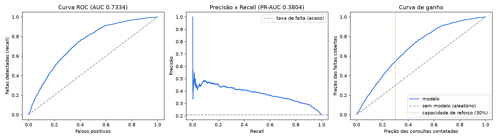
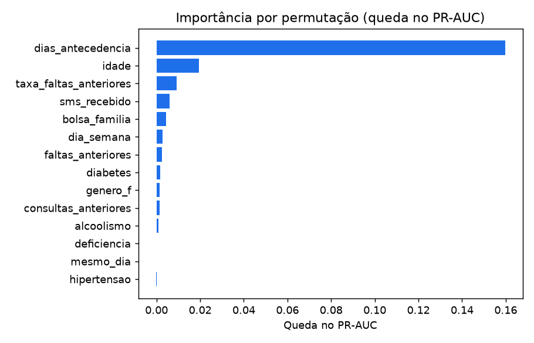

# Avaliação do modelo de previsão de falta

Gerado por `scripts/treinar.py` em 2026-11-18. Base: **kaggle_medical_appointment_no_shows_vitoria_2016**.

## Divisão temporal

Treino no passado, validação e teste no futuro, como seria em produção.

| Conjunto | Período | Consultas |
|---|---|---|
| treino | 2016-04-29 a 2016-05-20 | 67357 |
| validacao | 2016-05-24 a 2016-05-31 | 16710 |
| teste | 2016-06-01 a 2016-06-08 | 26449 |

## Comparação no conjunto de teste

Limiar escolhido na validação para sinalizar as 30% consultas de maior risco (capacidade de reforço da equipe). No teste, como a distribuição muda de uma semana para outra, o mesmo limiar sinalizou 25%.

| Modelo | ROC-AUC | PR-AUC | Recall | Precisão | F1 | Brier |
|---|---|---|---|---|---|---|
| Baseline (taxa média) | 0.5 | 0.1846 | 1.0 | 0.1846 | 0.3116 | 0.1512 |
| Regressão logística | 0.7237 | 0.3329 | 0.491 | 0.3159 | 0.3844 | 0.2225 |
| Gradient boosting | 0.7304 | 0.3426 | 0.4666 | 0.3379 | 0.392 | 0.2177 |

Modelo escolhido (maior PR-AUC na validação): **Gradient boosting**.

### Como ler

- Taxa real de falta no teste: 18.5%.
- Contatando 25% das consultas (as de maior risco), o modelo cobre **47% das faltas**. Sem modelo, contatar 25% ao acaso cobriria cerca de 25%.
- Entre as consultas sinalizadas, 34% de fato faltaram (contra 18% na média).
- Matriz de confusão: VP 2278, FP 4463, FN 2604, VN 17104.
- Priorizamos **recall** e **PR-AUC** porque a classe de interesse (falta) é minoritária e deixar de avisar quem vai faltar custa mais do que um lembrete a mais.

## Importância dos atributos

| Atributo | Queda no PR-AUC |
|---|---|
| dias_antecedencia | 0.1313 ± 0.0052 |
| idade | 0.0496 ± 0.0029 |
| taxa_faltas_anteriores | 0.0302 ± 0.0018 |
| faltas_anteriores | 0.0199 ± 0.0014 |
| genero_f | 0.0085 ± 0.0012 |
| sms_recebido | 0.0051 ± 0.0011 |
| dia_semana | 0.0044 ± 0.0026 |
| bolsa_familia | 0.0028 ± 0.0013 |
| alcoolismo | 0.0014 ± 0.0011 |
| deficiencia | 0.0007 ± 0.0003 |
| mesmo_dia | -0.0 ± 0.0001 |
| hipertensao | -0.0001 ± 0.0003 |
| diabetes | -0.0012 ± 0.0038 |
| consultas_anteriores | -0.0029 ± 0.0014 |

## Comportamento por grupo (uso responsável)

O modelo só decide **a intensidade do lembrete**, nunca o acesso à consulta. Mesmo assim, conferimos se algum grupo é sinalizado de forma muito diferente da sua taxa real de falta.

Duas políticas no mesmo modelo:

- **limiar único**: as consultas de maior risco no geral;
- **cota mínima por faixa etária**: além disso, em cada faixa as 15% de maior risco da própria faixa recebem reforço (limiares calibrados na validação). **É a política em uso na API.**

| Grupo | Consultas | Taxa real de falta | Sinalizada (único) | Recall (único) | Sinalizada (cota) | Recall (cota) |
|---|---|---|---|---|---|---|
| genero: F | 17314 | 18.3% | 25.8% | 46.7% | 27.1% | 47.8% |
| genero: M | 9135 | 18.8% | 24.9% | 46.7% | 26.1% | 47.7% |
| faixa_etaria: 0-11 | 4768 | 18.5% | 31.0% | 54.1% | 31.0% | 54.1% |
| faixa_etaria: 12-17 | 1730 | 24.5% | 47.1% | 70.3% | 47.1% | 70.3% |
| faixa_etaria: 18-29 | 3852 | 23.2% | 46.6% | 71.8% | 46.6% | 71.8% |
| faixa_etaria: 30-59 | 10828 | 18.0% | 21.8% | 40.0% | 21.8% | 40.0% |
| faixa_etaria: 60+ | 5271 | 13.9% | 5.5% | 11.0% | 11.9% | 18.5% |

No total, com a cota: sinaliza 26.8% das consultas, recall 47.8%, precisão 33.0% (limiar único: 25.5%, 46.7%, 33.8%).
